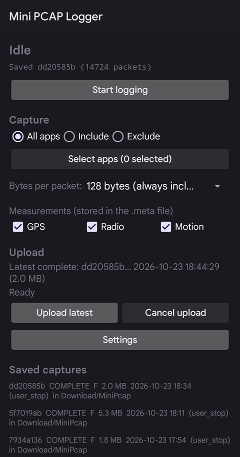
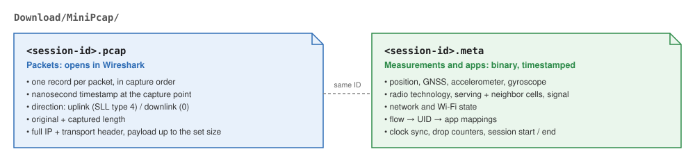
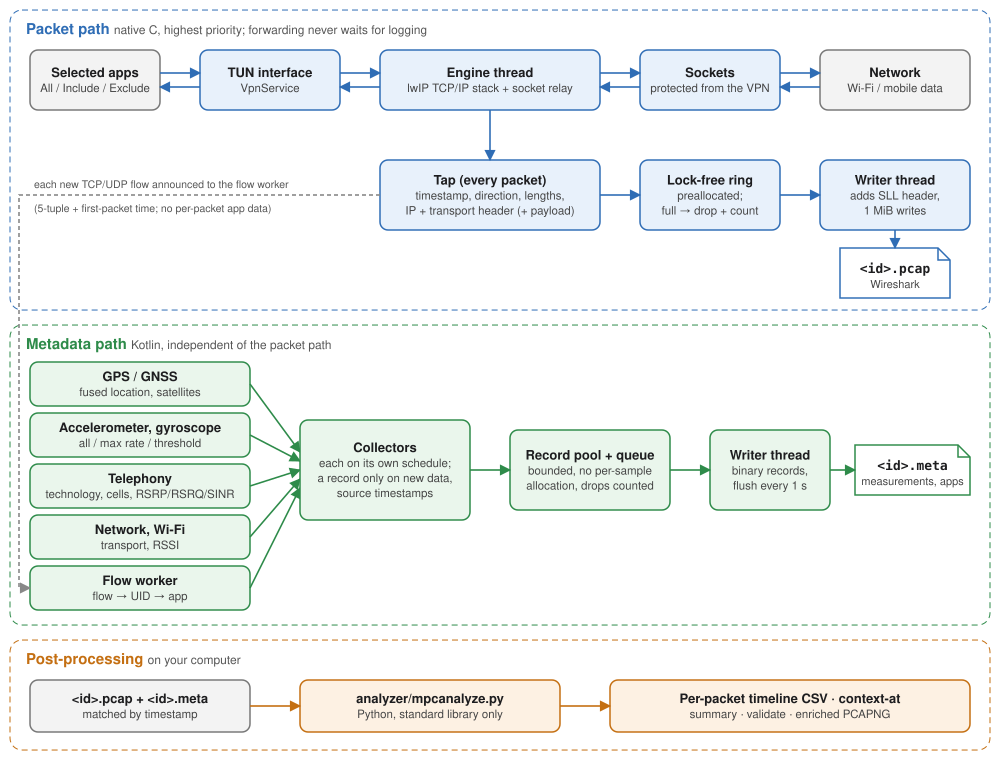

# MiniPcap — per-app packet logger for Android (no root)

MiniPcap records the network traffic of selected Android apps on the phone itself (an on-device VPN,
no root). Each session produces a **PCAP** file that opens directly in Wireshark, with uplink and
downlink marked on every packet, and a compact binary **metadata** file. That file holds position,
motion and radio measurements (serving and neighbor cells, signal strength, radio technology) plus app
ownership, each recorded asynchronously when it changes. A post-processing analyzer combines the two
by timestamp.

<p align="center"></p>

---

## Quick start

You need an Android 10+ phone.

1. Download `minipcap-<version>.apk` from the [latest release](https://github.com/thomas-lundgren/mini_pcap/releases/latest)
   and open it on the phone (allow installing from that source), or run `adb install minipcap-<version>.apk`.
   To build it yourself instead, see [Building from source](#building-from-source).
2. Open **MiniPcap** on the phone. Choose which apps to capture (**All**, **Include** or **Exclude**).
3. Tap **Start logging** and accept the VPN and notification prompts.
4. Use your apps as usual. The notification shows elapsed time, packets and file size.
5. Tap **Stop logging** in the notification (or in the app).
6. Copy the capture to your computer and open it:

   ```bash
   adb pull /sdcard/Download/MiniPcap/ .
   wireshark MiniPcap/<capture-id>.pcap
   python3 analyzer/mpcanalyze.py timeline MiniPcap/<capture-id>.pcap MiniPcap/<capture-id>.meta --csv > packets.csv
   ```

   Or connect the phone with USB file transfer and copy `Download/MiniPcap/` with your file manager.

That's it. The sections below explain what is in the files and what else the app can do.

---

## Contents

- [What you get](#what-you-get)
- [Using the app](#using-the-app)
- [Output files](#output-files)
- [Analysing captures](#analysing-captures)
- [Example: a bike ride](#example-a-bike-ride)
- [Uploading to a server](#uploading-to-a-server)
- [How it works](#how-it-works)
- [Performance](#performance)
- [Privacy](#privacy)
- [Limitations](#limitations)
- [Building from source](#building-from-source)
- [Testing and benchmarks](#testing-and-benchmarks)
- [Repository layout](#repository-layout)
- [License](#license)

## What you get

- **Per-app capture without root:** an Android `VpnService` carries the traffic of the apps you pick;
  other apps bypass it untouched.
- **Wireshark-ready PCAP:** nanosecond timestamps, direction on every packet (Linux SLL packet type),
  and at least the full IP + TCP/UDP header of every packet. You choose how much payload to keep beyond
  that.
- **Asynchronous measurements:** a binary `.meta` file records GPS, accelerometer/gyroscope samples,
  radio technology, serving and neighbor cells with RSRP/RSRQ/SINR, Wi-Fi and network state. Each
  source runs at its own rate, writes only on new data, and keeps its source timestamp.
- **App attribution:** UID → package mappings and flow → UID mappings, so the analyzer can name the
  app of every packet, including the first packets of a connection.
- **Analyzer:** reconstructs the device context for any packet or point in time, exports enriched
  CSV or PCAPNG, and marks missing or stale data explicitly.
- **Control from the notification:** a status line updated every second and a **Stop logging** button
  that works with the app closed.
- **Crash-safe files:** if Android kills the app mid-capture, the next launch repairs both files up to
  the last complete record.
- **Easy offload:** finished pairs are moved to `Download/MiniPcap/` for USB copying, or can be shared,
  or uploaded to your own HTTPS server.

## Using the app

### Choosing what to capture

| Setting | Meaning |
|---|---|
| **All** | Every app's traffic goes through the capture (except MiniPcap itself). |
| **Include** | Only the apps you select. Everything else bypasses the VPN. |
| **Exclude** | Everything except the apps you select. |
| **Bytes per packet** | **Headers only**, **128** (default), 256, 512 or full packet. Every option keeps at least the complete IP + TCP/UDP header; the original length is always recorded. |
| **GPS / Radio / Motion** | Which measurement sources write to the `.meta` file. Rates and modes are under **Settings → Measurements**. |

### Measurement settings

| Setting | Default | Meaning |
|---|---|---|
| Motion logging | up to the sampling rate | *every sample*, *up to the sampling rate*, or *only on change* (threshold) |
| Motion sampling rate | 50 Hz | requested sensor rate (independent of packet rate) |
| Threshold | 0.5 m/s² (rad/s) | change needed in threshold mode; unchanged values are still refreshed once per second |
| Include gyroscope | on | gyroscope samples next to the accelerometer |
| GPS minimum interval / distance | 1000 ms / 0 m | location update thresholds |
| Cell info refresh | 2000 ms | explicit modem refresh requests; reports in between are event driven |

### Starting and stopping

Start from the app. While recording, a notification shows the elapsed time, packet count and file size,
with a **Stop logging** action. Stopping flushes and closes the files, usually in under a second (2.6 s for a 6 GB capture).

If the app is force-stopped or killed instead, the capture is marked **recovered** on the next launch:
both files are cut back to their last complete record and a `SESSION_END` record marked "recovered"
is appended to the `.meta` file. At most about one second of metadata is lost, since the writer
flushes once per second.

### Where captures are stored

While recording, files live in the app's private storage. When a capture finishes, MiniPcap **moves**
the pair to `Download/MiniPcap/`. The copy is checked with SHA-256 before the private one is deleted, so
each capture exists in one place. You can turn this off in **Settings → Storage** to keep captures
private, and move individual ones later from **Saved captures**.

Tap a capture in **Saved captures** to share the pair, upload it, move it, or delete it.

## Output files

Each recording session produces two files with the same session ID:

<p align="center"></p>

For example `Download/MiniPcap/5b19ce96-9849-4644-9447-069c49759071.pcap` and the matching `.meta`.

The design rule: **packet capture stays simple and fast.** Every packet carries what is needed to
analyse it on its own (timestamp, direction, lengths, headers). Everything else is recorded once, as
independent timestamped events, and combined afterwards by the analyzer.

### `<id>.pcap`

A classic PCAP file (nanosecond timestamps) with link type `LINKTYPE_LINUX_SLL` (113). Each record is
a 16-byte Linux "cooked capture" header followed by the IP packet prefix:

| SLL field | Value |
|---|---|
| packet type | **4 = OUTGOING → uplink** (sent by the phone), **0 = HOST → downlink** (received) |
| ARPHRD type | `0xFFFE` (none, as Linux reports for TUN devices) |
| address | empty (no link layer exists on a VPN interface) |
| protocol | `0x0800` IPv4 or `0x86DD` IPv6 |

- **Direction** is visible in Wireshark immediately (`sll.pkttype`), without the `.meta` file.
- **Lengths** in the PCAP include the 16-byte SLL header. The original packet length is always kept.
- **How much is captured:** every record contains at least the complete IP and transport header,
  whatever size you configure. For example 40 bytes for IPv4+TCP, 48 for IPv6+UDP, and 72 for IPv6+TCP
  with the usual 12 bytes of TCP options. Configured sizes larger than that keep more payload. Header
  chains longer than 192 bytes (rare) are cut there.
- **Timestamps** are taken when the packet enters the capture path. They come from the monotonic
  boot clock and are converted to UTC with one anchor stored in the `.meta` header, so a wall-clock
  change during recording cannot shift or reorder packets. The exact monotonic time of every packet
  can be recovered.
- The SLL header exists only in the file. Packets on the network are never modified.

### `<id>.meta`

A compact, versioned binary log of **typed, timestamped records**. Each source writes only when it has
something new: a GPS fix, a cell report, a sensor sample, a newly resolved app. Nothing is repeated per
packet. The full specification is [`docs/META_FORMAT.md`](docs/META_FORMAT.md).

| Record | Content | When |
|---|---|---|
| `SESSION_INFO` | device, Android version, app version, capture and collector settings | once |
| `CLOCK_SYNC` | monotonic ↔ UTC pair | start, every 60 s, on time changes, stop |
| `LOCATION` | lat/lon, altitude, speed, bearing, accuracies, provider; fix timestamp | each new fix |
| `GNSS_STATUS` | satellites visible/used, mean C/N0 | on change, ≤ 1 Hz |
| `MOTION_SAMPLE` | accelerometer (and gyroscope) X/Y/Z with the sensor's own timestamp | every sample, max rate, or on change |
| `RADIO_STATE` | data network type (LTE, NR, …), 5G NSA/advanced override, data state and activity, service state, operator | on change |
| `CELL_IDENTITY` | serving cells: RAT, MCC/MNC, cell ID, PCI, ARFCN, TAC, bands, bandwidth | serving cell change + periodic refresh |
| `CELL_MEASUREMENT` | serving and neighbor cells: LTE RSRP/RSRQ/SINR/RSSI/CQI/TA, NR SS-RSRP/RSRQ/SINR and CSI values, WCDMA, GSM | each new modem report |
| `SIGNAL_STRENGTH` | serving signal strength (often updated more often than cell info) | each report |
| `NETWORK_STATE`, `WIFI_STATE` | default network transport, validated/metered, bandwidth estimates; Wi-Fi RSSI, frequency, link speeds, standard | on change + refresh |
| `UID_MAPPING` | UID → packages, app names, class | first time an app is seen |
| `FLOW_MAPPING` | flow 5-tuple + exact first-packet time → UID (or why unknown) | when the lookup finishes |
| `SENSOR_STATUS`, `DROPPED_EVENTS`, `CAPTURE_STATS`, `SESSION_END` | source availability and permissions, metadata loss, capture counters, final status | as they happen |

- **Timestamps:**
  - Every record has a monotonic timestamp in nanoseconds (`elapsedRealtimeNanos`, the same clock as
    the packets).
  - A record's timestamp is the measurement's own time when Android provides one (sensor event, GPS
    fix, modem report), flagged as such. Otherwise it's the time the logger received the measurement.
  - Records carrying a source timestamp also store the receive time, so delivery delay is visible.
- **Missing data:** values Android doesn't provide are marked unavailable, never estimated. Missing
  permissions, sensors or switched-off sources are recorded as `SENSOR_STATUS`.
- **Extensibility:** new record types don't change the packet file, and readers skip unknown record
  types by their length.

## Analysing captures

**In Wireshark:** open the `.pcap`. Direction is the SLL packet type:

| To see | Display filter |
|---|---|
| uplink (sent by the phone) | `sll.pkttype == 4` |
| downlink (received) | `sll.pkttype == 0` |

**With the analyzer:** `analyzer/mpcanalyze.py` (Python 3.8+, standard library only) reads both files,
puts every timestamp on the common monotonic clock, and reconstructs the device context of each packet.
It never modifies the inputs.

```bash
A=analyzer/mpcanalyze.py
python3 $A summary    <id>.pcap <id>.meta              # counts, apps, sources, drops
python3 $A timeline   <id>.pcap <id>.meta --csv > packets.csv
python3 $A context-at <id>.pcap <id>.meta 2026-10-23T09:14:05.120Z   # or epoch seconds, or boot:<ns>
python3 $A dump       <id>.meta --type CELL_MEASUREMENT   # decoded records as JSON lines
python3 $A export-pcapng <id>.pcap <id>.meta enriched.pcapng   # Wireshark copy with app/cell/position comments
python3 $A validate   <id>.pcap <id>.meta
```

How each kind of metadata is matched to a packet:

| Kind | Examples | Method |
|---|---|---|
| state | serving cell, network technology, connectivity, app mapping | latest valid state before the packet |
| sample | RSRP, RSRQ, SINR | latest measurement before the packet, with its age; flagged stale after `--stale-after` (10 s) |
| continuous | position | linear interpolation between fixes at most `--max-location-gap` (5 s) apart, otherwise the latest fix with its age; never interpolated across gaps |
| continuous | acceleration, rotation | mean and max magnitude over `--motion-window` (1000 ms) before the packet |
| flows | app per packet | the packet's 5-tuple is matched to the `FLOW_MAPPING` with the same 5-tuple and the latest first-packet time not after the packet, so a reused port pair maps to the right app |

The `timeline` CSV has one row per packet with these columns:

- **packet:** time, direction, lengths, addresses, protocol, ports, flow ID
- **app:** UID, packages, app class, and why the app is unknown when it is
- **radio:** data network type, override, serving cell RAT/PCI/ARFCN/cell ID, RSRP/RSRQ/SINR with age
  and stale flag, number of neighbor cells
- **Wi-Fi:** RSSI
- **position and motion:** position with status (`interpolated`, `latest`, `stale`,
  `before_first_fix`) and fix age, acceleration and gyro statistics

## Example: a bike ride

A real 10-minute capture from a Pixel 9 Pro on a bike ride: mobile data only (LTE with 5G NSA), Google Maps
navigating and Spotify playing, all apps captured at 128 bytes per packet. IP addresses and positions are
left out here, but both are in the files.

**Every packet with its app and the device context at that moment** (`timeline`, selected columns and
rows):

| Time (UTC) | Dir | App | Proto | Port | Length | Captured | Flow | Radio | RSRP | Speed | Fix acc. | Accel max |
|---|---|---|---|--:|--:|--:|--:|---|--:|--:|--:|--:|
| 16:38:30.356 | UL | Maps | UDP | 443 | 313 | 128 | 20 | LTE + NR_NSA | -93 dBm | 31.8 km/h | 2.5 m | 10.3 m/s² |
| 16:38:30.475 | DL | Maps | UDP | 443 | 61 | 61 | 20 | LTE + NR_NSA | -93 dBm | 31.8 km/h | 2.5 m | 10.3 m/s² |
| 16:38:30.483 | UL | Maps | UDP | 443 | 62 | 62 | 20 | LTE + NR_NSA | -93 dBm | 31.8 km/h | 2.5 m | 10.3 m/s² |
| 16:38:30.506 | DL | Maps | UDP | 443 | 1273 | 128 | 20 | LTE + NR_NSA | -93 dBm | 31.8 km/h | 2.5 m | 10.3 m/s² |
| 16:38:30.509 | DL | Maps | UDP | 443 | 1278 | 128 | 20 | LTE + NR_NSA | -93 dBm | 31.8 km/h | 2.5 m | 10.3 m/s² |
| 16:38:30.515 | UL | Maps | UDP | 443 | 69 | 69 | 20 | LTE + NR_NSA | -93 dBm | 31.8 km/h | 2.5 m | 10.3 m/s² |
| 16:38:32.959 | UL | Spotify | TCP | 443 | 248 | 128 | 106 | LTE + NR_NSA | -93 dBm | 32.2 km/h | 2.5 m | 10.3 m/s² |
| 16:38:32.979 | UL | Spotify | TCP | 443 | 1044 | 128 | 106 | LTE + NR_NSA | -93 dBm | 32.2 km/h | 2.5 m | 10.3 m/s² |
| 16:38:32.979 | DL | Spotify | TCP | 443 | 60 | 60 | 106 | LTE + NR_NSA | -93 dBm | 32.2 km/h | 2.5 m | 10.3 m/s² |
| 16:38:33.028 | UL | Spotify | TCP | 443 | 88 | 88 | 120 | LTE + NR_NSA | -93 dBm | 32.2 km/h | 2.5 m | 10.3 m/s² |
| 16:38:33.068 | DL | Spotify | TCP | 443 | 60 | 60 | 106 | LTE + NR_NSA | -93 dBm | 32.2 km/h | 2.5 m | 10.3 m/s² |
| 16:38:33.088 | DL | Spotify | TCP | 443 | 84 | 84 | 120 | LTE + NR_NSA | -93 dBm | 32.2 km/h | 2.5 m | 10.3 m/s² |

- **Dir** comes from the PCAP itself (SLL packet type 4 = UL, 0 = DL); everything after **Captured**
  comes from the `.meta` file, matched by timestamp.
- **Length** is the original IP packet size; **Captured** is what was stored: up to 128 bytes, and
  always at least the full IP + transport header.
- **Flow** is the connection; the app comes from that flow's `FLOW_MAPPING`, so packets of different
  apps that interleave in time are still separated: Maps flow 20 (QUIC) and Spotify flows 106 and 120 (TCP).
- **RSRP** is the serving cell's latest measurement; **Speed** and **Fix acc.** come from the latest
  location fix; **Accel max** is the strongest acceleration in the second before the packet (the bumps of
  the road).

**Traffic per app** in the same capture (every packet attributed; totals equal the PCAP):

| App | UL packets | UL bytes | DL packets | DL bytes |
|---|--:|--:|--:|--:|
| Google Maps | 2,561 | 978 KiB | 7,399 | 8,076 KiB |
| Spotify | 1,379 | 386 KiB | 1,123 | 800 KiB |
| Google Play services | 433 | 171 KiB | 455 | 248 KiB |
| Google app | 94 | 31 KiB | 96 | 69 KiB |
| Other apps, system (DNS, GPS assistance, root) and unattributed | 717 | 131 KiB | 467 | 43 KiB |
| **Total** | **5,184** | **1.7 MiB** | **9,540** | **9.0 MiB** |

To split a capture by app yourself, group the `timeline` CSV by `packages` and `direction`:

```bash
python3 analyzer/mpcanalyze.py timeline <id>.pcap <id>.meta --csv > packets.csv
python3 - <<'PY'
import csv, collections
t = collections.defaultdict(lambda: [0, 0])
for r in csv.DictReader(open("packets.csv")):
    k = (r["packages"] or "unattributed", r["direction"])
    t[k][0] += 1
    t[k][1] += int(r["orig_len"])
for (app, d), (n, b) in sorted(t.items(), key=lambda x: -x[1][1]):
    print(f"{app:45} {d:9} {n:8} packets {b / 1024:10.0f} KiB")
PY
```

To keep only one app's packets in Wireshark, take its flows' ports from the CSV, or write a per-app
PCAPNG with `export-pcapng`, whose packet comments name the app, and filter on `frame.comment contains
"com.spotify.music"`.

## Uploading to a server

MiniPcap can send the newest finished session (its `.pcap` and `.meta` together) to an HTTPS server you control. Upload is
always started by you, never automatic, and is disabled while recording.

1. Run a receiver. A reference implementation (Python standard library only) is included:

   ```bash
   cd validation/upload-server
   ./make_certs.sh <your-computer-LAN-IP>    # test CA + server certificate (debug builds trust this CA)
   python3 -I receiver.py --port 9443 --cert certs/server.pem --key certs/server.key \
          --data data --token-file token.txt
   ```

2. In **Settings**, enter `https://<your-computer-LAN-IP>:9443`, optionally an API token (stored
   encrypted with the Android Keystore), and tap **Test**.
3. Tap **Upload latest**. Progress appears in a notification. Success is shown only after the server's
   receipt confirms the SHA-256 of both files. Retrying the same capture is safe and returns the same
   receipt.

The wire protocol is specified in [`docs/UPLOAD_PROTOCOL.md`](docs/UPLOAD_PROTOCOL.md). Release builds
accept only HTTPS with system-trusted certificates.

## How it works

<p align="center"></p>

- **Forwarding:** traffic from the TUN interface goes into a vendored [lwIP](third_party/lwip/VENDORED.md)
  stack that terminates TCP/UDP locally and relays it over ordinary sockets. MiniPcap excludes itself
  from the VPN, so its own sockets go straight to the network.
- **Packet capture:** each packet is tapped where it crosses the TUN interface. The packet path never
  calls into Java, allocates memory, formats text or touches the disk. It copies the packet prefix
  into a ring buffer and moves on. If the writer falls behind, records are dropped and counted, and
  forwarding is never slowed down.
- **Metadata:** collectors run on their own threads, encode compact binary records into pooled
  buffers and hand them to a writer thread. They never block. If the pool is exhausted, the record is
  dropped and reported as `DROPPED_EVENTS`, while packet capture is unaffected.
- **App attribution:** each new flow's 5-tuple and exact first-packet time go to a Kotlin worker,
  which asks Android for the owning UID once per flow (with retries) and records a `FLOW_MAPPING`,
  resolved or not. The analyzer uses it to attribute every packet of the flow, including those before
  the answer arrived.
- **Correlation happens afterwards:** the phone only records. Interpolation, staleness and per-packet
  context are computed by the analyzer, so the files stay small and the capture path stays cheap.

**Code structure.** The Kotlin code is layered, and its package dependency graph is acyclic. Each
layer depends only on layers below it:

| Layer | Packages | Depends on |
|---|---|---|
| 5 | `ui` | everything below |
| 4 | `service`, `upload` | `session`, `storage`, `notify` (+ `capture`, `meta.*`, `core`) |
| 3 | `storage` (export) | `session`, `core` |
| 2 | `session` | `capture`, `meta`, `meta.apps`, `meta.collect`, `core` |
| 1 | `meta.apps`, `meta.collect` | `meta` (`meta.apps` also `capture`) |
| 0 | `core`, `capture`, `meta`, `notify` | nothing in the app |

- `session/CaptureSession` owns one recording: native start, `MetaSession`, the flow-owner worker,
  ordered teardown and finalization.
- `service/CaptureVpnService` is only the Android shell: VPN, foreground service, notification
  and ticker.
- The format code (`meta/MetaFormat`, `MetaRecords`, `MetaWriter`, `capture/PcapFormat`) is pure JVM
  and tested without a device.

Design decisions and their reasons are recorded in [`docs/DECISIONS.md`](docs/DECISIONS.md).

## Performance

Measured on a Pixel 9 Pro (Android 17) over Wi-Fi, with three repeats per configuration, using the
previous PCAPNG writer (the forwarding and tap path are unchanged; a rerun with the PCAP + `.meta`
format and measurement collectors is pending). Full method,
raw data and environment are in [`docs/TEST_RESULTS.md`](docs/TEST_RESULTS.md) and
[`validation/perf/results/`](validation/perf/results/).

| Workload | No VPN | VPN, no capture | VPN + full capture |
|---|---|---|---|
| UDP 5,000 packets/s | 0.020 % loss, 7.18 ms median RTT | 0.019 %, 7.48 ms | 0.023 %, 7.63 ms |
| TCP download | 180 Mbit/s | 177 Mbit/s | 165 Mbit/s (runs 158–183) |
| TCP upload | 111 Mbit/s | 115 Mbit/s | 120 Mbit/s |

- **Capture cost:** about **+3–5 % app CPU** above VPN forwarding alone. The writer thread spends
  0.5–1.2 µs per packet, and UID lookups run about once per connection.
- **Slow storage:** with the writer frozen for 5 seconds under load, app traffic lost 0.04 % and every
  dropped capture record was counted.
- **One-hour soak:** 23.6 million packets, no capture drops, memory flat (RSS 160–198 MB), and 3,108
  of 3,128 flows attributed to an app.

**Current code, host micro-benchmarks** (development PC, not the phone; reproducible with the
commands under [Testing and benchmarks](#testing-and-benchmarks)):

| Component | Result |
|---|---|
| Native tap (parse, flow lookup, ring copy) | 70–90 ns per packet; 0 bytes allocated |
| Packet file size | 74 bytes per record in headers-only mode (16 B PCAP + 16 B SLL + headers) |
| Native writer | about 4 million headers-only records/s to disk |
| Metadata writer | about 1.6 million records/s; about 1.5 bytes allocated per motion sample |
| Analyzer | about 60,000–70,000 packets/s with flat memory (about 6 minutes for a 1-hour, 23M-packet capture) |

The device numbers come from one phone and one network, and from a build whose TCP relay could keep
one core busy while an app slowly drained a finished download (fixed since), so their CPU figures may
be on the high side. Battery use, cellular networks, other Android
versions and the measurement collectors' overhead have not been measured yet. See
[`docs/STATUS.md`](docs/STATUS.md) and the coverage map in [`docs/TEST_COVERAGE.md`](docs/TEST_COVERAGE.md).

## Privacy

Packet prefixes can contain domain names, cookies, tokens or message content. **Headers only** keeps no
payload; the 128-byte default keeps a little, and is **not** a privacy guarantee. While recording, files stay in app-private
storage. After the move, files in `Download/MiniPcap/` can be copied by anyone with the unlocked phone
and a USB cable, and read by apps with all-files access. Turn the move off if that matters, and delete
captures you no longer need. With GPS and radio measurements on, the `.meta` file also contains your
**precise location track** and nearby cell and Wi-Fi identifiers. Switch **GPS** and **Radio** off if
you don't need them. MiniPcap does not intercept TLS and sends nothing anywhere unless you
press **Upload**.

## Limitations

- **Capture point:** packets are recorded at the VPN interface, not the radio. TCP is terminated
  locally, so handshake timing and downlink segmentation are the on-device stack's, not the server's.
- **ICMP is not forwarded:** `ping` fails while capturing. MiniPcap's own traffic and excluded apps are
  never captured.
- **Unresolved apps:** very short UDP flows (e.g. some system DNS queries) can end before Android
  reports their UID, so they stay `unresolved`.
- **One VPN at a time:** starting another VPN ends the capture (`stop_reason: vpn_revoked`).
- **Measurements are not per packet:** each source reports at its own rate. Cell measurements
  refresh only as often as the modem and Android allow, often every few seconds with the screen off.
  Neighbor cells are what the modem reports, and Wi-Fi neighbors (scans) are not recorded. Recording
  location and high-rate motion costs battery.
- **Flows need headers:** the analyzer matches packets to apps by their 5-tuple, which is why every
  record keeps the transport header. Non-initial IP fragments have no ports and stay unattributed.
- **Older captures:** sessions recorded before this format (`.pcapng` + `.meta.json`) can still be
  shared, moved and read with `validation/scripts/pcapng_tool.py`, but not uploaded.
- **Recovered captures:** captures saved after a force-stop are kept and can be moved or shared, but
  **Upload latest** only picks complete ones.

## Building from source

**Requirements**
- JDK 17
- Android SDK with platform 36, NDK `27.2.12479018` and SDK CMake 3.22.1
- `local.properties` with `sdk.dir=…` (Android Studio creates it)

**Build and install**

```bash
./gradlew assembleDebug                      # app/build/outputs/apk/debug/app-debug.apk
adb install -r app/build/outputs/apk/debug/app-debug.apk
./gradlew assembleRelease                    # signed if ~/.android/minipcap-release.properties exists
```

Release signing reads `storeFile`, `storePassword`, `keyAlias` and `keyPassword` from
`~/.android/minipcap-release.properties`, or from the path in `-Pminipcap.signing=<file>`. Without
that file the release APK is unsigned. The debug and release builds use different keys, so switching
between them requires uninstalling the app.

The app targets API 35 and runs on Android 10 (API 29) and newer. The debug build also trusts the
test CA from `make_certs.sh` and accepts automation commands from `adb` (see below). Release builds do
neither.

## Testing and benchmarks

**Tests** (the requirement → test map is [`docs/TEST_COVERAGE.md`](docs/TEST_COVERAGE.md))

```bash
./validation/scripts/check_native.sh                 # native C tests + PCAP checked by the analyzer reader and tshark
./native/build-host/bench_capture 2000000 /tmp       # native capture-path performance per packet-size mode
./gradlew testDebugUnitTest                          # JVM: format, writer, recovery, export, upload, performance,
                                                     #      Kotlin-written session decoded by the Python analyzer
python3 -I validation/upload-server/test_receiver.py # receiver protocol tests
python3 -I analyzer/test_mpcanalyze.py               # analyzer correlation edge cases + scaling
python3 -I validation/scripts/device_meta_check.py --host <computer-LAN-IP>   # on the phone: acceptance check
```

The native tests need gcc, cmake and ninja. The PCAPNG checks also use `tshark`/`capinfos`
(Wireshark ≥ 4.2) and Python 3.10+.

**Benchmarks**

These compare no VPN, VPN-only and each capture stage on the same device (debug build):

```bash
validation/perf/build_nettool.sh && native/build-nettool-host/nettool server 5201 &
adb shell appops set dev.minipcap ACTIVATE_VPN allow
python3 -I validation/perf/bench.py --host <computer-LAN-IP> --repeats 3 --stall
python3 -I validation/perf/summarize.py validation/perf/results/<device>/<date> --md summary.md
python3 -I validation/perf/soak.py --host <computer-LAN-IP> --minutes 60
```

**Debug automation**

Debug builds accept commands such as:

```bash
adb shell am start -n dev.minipcap/.ui.MainActivity --es cmd start
```

The commands are `start`, `stop`, `stall`, `upload`, `server`, `move` and `automove`; `start` also
takes `--ei snaplen`, `--ez gps/radio/motion`, `--ei motion_hz` and `--es motion_mode`. The `server`
command puts the token on the adb command line, where adbd logs it, so use it only with throwaway
test tokens.

## Repository layout

```
analyzer/                  mpcanalyze.py: reads .pcap + .meta, correlation, timeline, context-at, export
app/src/main/java/dev/minipcap/
  core/                    files and atomic writes (pure JVM)
  capture/                 native bridge, capture settings, PCAP format (recovery scan)
  meta/                    metadata format, typed record encoders, non-blocking writer (pure JVM)
  meta/collect/            one collector per source (clock, location, motion, radio, network) + settings
  meta/apps/               flow-owner worker (FLOW_MAPPING), package lookup (UID_MAPPING), class rules
  session/                 session store, process registry, CaptureSession lifecycle, MetaSession
  storage/                 move to Download/MiniPcap, share provider
  upload/                  HTTPS client, upload job, settings
  service/                 VpnService shell;  notify/  notification builders;  ui/  activities
native/                    C data plane: engine.c (event loop, TUN I/O + capture tap, lwIP gateway,
                           lifecycle), relay_tcp.c, relay_udp.c, capture.c (flow table, ring, writer),
                           pcap.c (PCAP + SLL), packet.c, flow.c, ring.c, jni.c
  tests/                   host unit tests        tools/nettool.c   workload generator for benchmarks
third_party/lwip/          vendored lwIP fork (heiher/lwip @ e6d5fc6, BSD-3-Clause)
validation/scripts/        check_native.sh (native gate), device_lifecycle.py,
                           pcapng_tool.py (reader for captures made before the PCAP + .meta format)
validation/upload-server/  reference HTTPS receiver, its tests, test-certificate script
validation/perf/           benchmark and soak scripts, recorded results
docs/                      META_FORMAT, STATUS, TEST_RESULTS, DECISIONS, PERFORMANCE_PLAN, UPLOAD_PROTOCOL
```

## License

MIT, see [`LICENSE`](LICENSE). The vendored lwIP code in `third_party/lwip/` keeps its own
BSD-3-Clause license ([`third_party/lwip/LICENSE`](third_party/lwip/LICENSE)).
